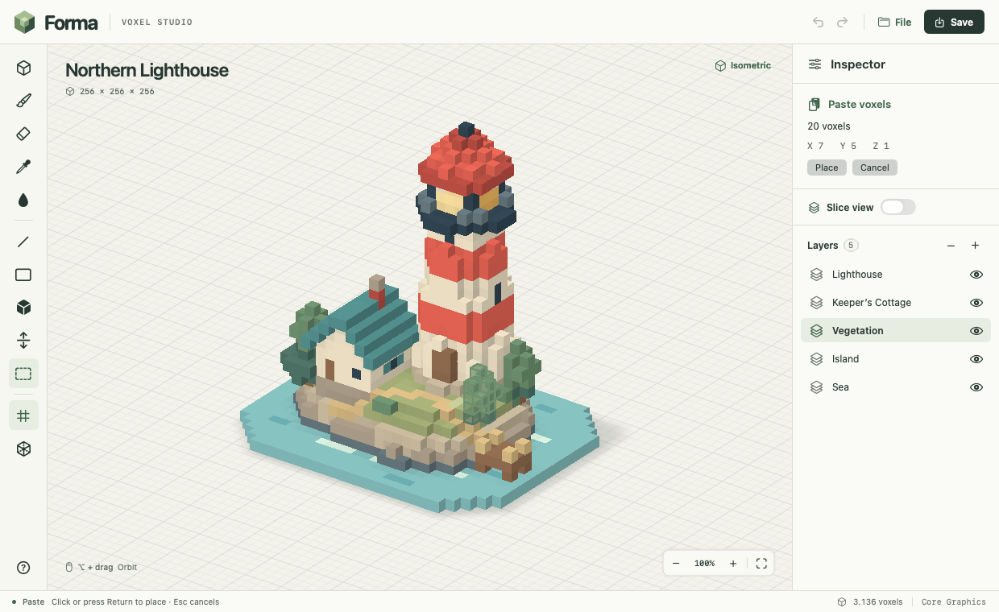

# Forma — voxel editor for macOS

Forma is a native Swift and Metal editor for building, painting, and editing voxel models on a 256 × 256 × 256 grid. Organize a scene into layers, sample colors directly from a model, and exchange `.vox` files with MagicaVoxel. The canvas and inspector follow the Mac’s light or dark appearance.



**Cape Meridian lighthouse.** Build a lighthouse, keeper’s cottage, and jetty from an empty grid in Forma. [Watch the screen recording (MP4)](Media/Cape-Meridian.mp4) · [Open the scene in Forma (VXL)](Media/Cape-Meridian.vxl) · [Get the MagicaVoxel model (VOX)](Media/Cape-Meridian.vox)

**Flowering cactus.** A 35-second demo shows how to build a flowering cactus from an empty grid, paint its details, and orbit the finished model. [Watch the demo (MP4)](Media/Drawing-demo.mp4) · [Get the finished model (VOX)](Media/Desert-Bloom.vox)

## Build and run

The app runs on macOS 13 or later. To build from source, use Xcode 15 or later, or the corresponding Xcode Command Line Tools. There are no external package dependencies.

```sh
git clone https://github.com/makarov-mm/VoxelEditor.git
cd VoxelEditor
./build-app.sh
open build/Forma.app
```

The script builds a universal `Forma.app` for Apple Silicon and Intel and signs it locally. You can copy the bundle to Applications.

## Start drawing

The editor opens with **Northern Lighthouse**, a five-layer scene you can edit immediately. To start from scratch, press **⌘N**, choose a color in the inspector, and click the floor to place your first voxel. Click an exposed face to build outward. Drag to draw a stroke, then press **⌘Z** to undo the whole stroke.

| Action | Control |
| --- | --- |
| Add / paint / erase / sample color / select | `V` / `B` / `E` / `I` / `S` |
| Line / rectangle / box / cylinder | `L` / `R` / `O` / `C` |
| Extrude / flood fill | `X` / `K` |
| Toggle horizontal slice / lower or raise the cut | `Y` / `,` or `.` |
| Decrease / increase brush size or shape depth | `[` / `]` (brush 1–8, box or cylinder depth 1–256) |
| Orbit | Right-drag or `⌥` + drag |
| Pan | `⇧` + drag |
| Zoom | Scroll or pinch |
| Fit the scene in the current view | `F` |
| Toggle floor grid / voxel edges | `G` / `W` |
| Undo / redo | `⌘Z` / `⇧⌘Z` |

Choose the active layer in the inspector before painting or erasing. The eyedropper can sample any visible layer.

Click the lock in a layer row to protect its voxels, name, and deletion. Locks are saved in Forma projects. Click **Solo** to work on the active layer in isolation. Click it again to restore the previous view. PNG captures the isolated view, while model exports keep the scene’s regular layer visibility.

## Mirror strokes

With **Add**, **Paint**, or **Erase** active, turn on **Mirror X**, **Mirror Z**, or both in the inspector. The brush preview shows where the stroke will land. Each axis reflects across the middle of the grid, between cells −1 and 0. A single undo reverses the entire stroke, including its reflections.

## Select and move voxels

Press **S** and click a voxel on the active layer. Drag a box to select a region, including voxels behind the front row. **⌘-click** toggles individual voxels and **⌘-drag** adds a box to the selection. **⌘A** selects the editable voxels on the active layer.

Double-click a voxel to select its whole connected part, including voxels of other colors. The selection follows shared faces on the active layer and stops at the current slice. Parts that touch only at an edge or corner stay separate.

Drag a selected voxel along the plane of the face you grabbed. For a one-voxel move, use the **X**, **Y**, or **Z** controls in the inspector. The left and right arrows move along X, the up and down arrows move along Z, and **Page Up / Page Down** move along Y. A move is blocked if any voxel would leave the grid or collide with another visible voxel. **Esc** cancels a drag or clears an idle selection. **⌘Z** undoes a completed move.

To reuse a detail, select it and press **⌘D**. Forma places the copy next to the original and selects the copy so you can move it immediately. In the inspector, choose **X**, **Y**, or **Z** to turn the selection 90° around that axis. A completed duplication or rotation takes one undo step.

## Select and recolor by color

Press **S**, choose a swatch in the inspector, and click **Select by Color**. Forma selects every editable voxel on the active layer with that hex color, including disconnected parts. The current slice limits the selection. You can also sample a voxel with the eyedropper (**I**) and choose **Edit → Select by Color**.

Choose a new swatch and click **Recolor Selection** to apply its RGB color. Each voxel keeps its material and opacity. The selection stays active, and **⌘Z** restores the original colors in one step. For example, in **Cape Meridian**, selecting `#BE523F` on the **Tower masonry** layer picks out 66 red voxels.

## Copy details between layers and projects

1. Press **S** and select a detail on the active layer. **⌘C** copies it to the macOS clipboard. **⌘X** cuts it. **Delete** removes the selection and keeps the clipboard contents.
2. Choose the destination layer, or open another Forma project. Press **⌘V** to preview the fragment at its original coordinates. Press **Return** immediately to place it there.
3. To place it elsewhere, move the pointer over a voxel face or the work plane and click. For one-cell adjustments, use the arrow keys for X and Z or **Page Up / Page Down** for Y, then press **Return**. A red preview marks a collision, the grid boundary, or the slice limit. Press **Esc** to cancel.

A fragment can contain up to two million voxels and preserves each voxel’s color and MagicaVoxel material. Once placed, the fragment is selected for moving or rotating. Cut, Delete, and Paste each take one undo step. To transfer a detail to another layer at the same coordinates, cut it before switching layers.

## Shapes, extrusion, and fill

- **Line (L)** draws between two cells on the face or work plane where you start dragging.
- **Rectangle (R)** fills the area between two opposite corners on that plane.
- **Box (O)** uses the same drag for its footprint. Set the depth in the inspector before dragging to extend the box outward from the starting face. The live readout shows the dimensions before you release. Shapes add voxels in the active color and preserve existing voxels.
- **Cylinder (C)** creates a filled disc or cylinder. Drag opposite corners of the base on the grid or on a voxel face. A square footprint gives a circle, and a wider footprint gives an ellipse. Set **Depth** to 1 for a disc or increase it to build a tower section. On a wall, depth extends outward from its face.
- **Extrude (X)** pulls a connected patch of exposed faces outward. Drag in the direction of the face normal and release at the desired depth. When looking straight at the face, drag upward. Each column inherits the ink of its starting voxel. An occupied destination blocks the entire extrusion.
- **Fill (K)** replaces a connected region on the active layer with the active ink. Voxels must share a face and match the starting ink, including its material. The fill stops at empty space, other inks, and layer boundaries.

Each shape or extrusion can place up to 262,144 voxels in one action. Press **Esc** to discard the preview. A completed shape, extrusion, or fill takes one undo step.

## Work in a horizontal slice

Press **Y** to enable the cut, then choose a height in the inspector or use **,** and **.** to step down or up. Voxels above that height disappear from the viewport so you can reach an interior. In empty space, the cut height becomes the drawing plane. Turn off the cut to see the entire scene again.

Try a cut at **Y = 4** in the five-layer cottage project to reveal the table inside. [Open the Keeper’s Cottage example (VXL)](Media/Keepers-Cottage.vxl)

PNG export follows the current cut. Native projects and model exports preserve geometry above it.

## File formats

| Format | Open | Save or export | Contents |
| --- | --- | --- | --- |
| Forma project (`.vxl`) | **File → Open…** | **Save** (`⌘S`) or **Save As…** | Editable layers, visibility, voxels, and palette in versioned JSON |
| MagicaVoxel (`.vox`) | **File → Open…** or **Import MagicaVoxel (.vox)…** | **File → Export MagicaVoxel (.vox)…** | Static models, placement, colors, and supported material metadata |
| Scene image (`.png`) | — | **File → Export Scene PNG…** (`⇧⌘P`) | Visible layers from the current camera, with the current appearance, floor grid, and edge settings. Editing overlays are omitted. |
| Wavefront (`.obj` + `.mtl`) | — | **File → Export Wavefront OBJ…** | Mesh of the visible surface and its color materials. Keep the two files together. |

PNG export renders at twice the viewport’s point dimensions, up to 4096 pixels on its longest side.

Opening a `.vox` creates an editable Forma project. Use **⌘S** to keep a native copy, or **Export MagicaVoxel (.vox)…** to take the edited model back to MagicaVoxel. VOX export includes hidden layers and preserves their visibility.

Forma reads VOX versions 150 and 200 and writes version 150. A scene can span 256 cells on each axis, with up to 128 objects, two million voxels, and 255 occupied palette entries for VOX exchange. Animated scene nodes open at their earliest frame. Keep the original MagicaVoxel file for animation tracks, cameras, and render settings.

## Development

Open `Package.swift` in Xcode, or use Swift Package Manager from the repository root.

```sh
swift run Forma   # Launch the editor
swift test        # Run the editing, file-format, and PNG export tests
```

The interface uses SwiftUI and AppKit. The viewport uses MetalKit with a Core Graphics fallback when Metal is unavailable. The tests cover brush and shape edits, selection transforms and undo, clipboard round trips and placement, layer and slice visibility, PNG rendering, and MagicaVoxel round trips.

## License

Forma is available under the [MIT License](LICENSE).
